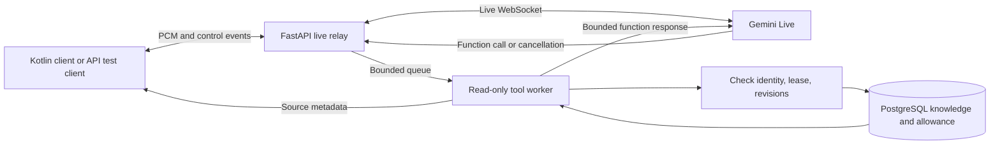

# Phase 7: optional read-only tools and knowledge

This phase adds relevant knowledge lookup during a live voice conversation. The backend still relays PCM in both directions; Gemini decides when to request a function, and the backend validates and executes it. No separate summarization, embedding, extraction, or ingestion model is used. Knowledge ingestion itself adds no model API calls. Sending declarations and retrieved text to Gemini can increase token usage, latency, and provider cost.

## Scope and architecture



Only these functions are declared and executable:

| Function | Arguments | Result |
| --- | --- | --- |
| `search_knowledge` | `query`, optional `limit` (default 3, maximum 5) | Accessible titles, IDs, versions, URLs, and short excerpts |
| `get_knowledge_entry` | `entry_id`, `expected_version`, optional `offset` and `max_chars` | One version-checked excerpt with an optional continuation offset |
| `get_usage_allowance` | Empty object | Current authenticated user's daily available/reserved seconds, remaining session seconds, UTC reset time |

There are no write tools. A function name never resolves to arbitrary Python code, SQL, shell commands, or URLs. Call arguments cannot select a user or tenant. User and ownership come from the authenticated session. References are lower-trust data: backend prompt instructions forbid treating their text as commands or authorization. The allowlist and database visibility checks enforce authority independently of model behavior.

The declarations use `BLOCKING`, so Gemini may wait for the result before generating its answer. The backend's upload and receive tasks remain independent of the lookup worker. This is full duplex transport with bounded read tools; it is not a claim that the model continues generating through every tool call. The SDK adapter serializes outbound audio and function-response writes with a lock.

## Enable and migrate

1. Stop the older backend. Back up the application database using your normal operator process.
2. Apply migrations using the owner connection: `./scripts/migrate.ps1`. The new head is `0005_knowledge_tools`.
3. Run the updated `scripts/database_grants.sql` as the owner. The runtime needs CRUD on `knowledge_entries` and SELECT/UPDATE on the seeded singleton `knowledge_state`. It does not need permission to create indexes, modify prompt versions, or promote administrators.
4. Keep `LIVE_TOOLS_ENABLED=false` for ordinary audio-only operation. To test tools, set it to `true` and restart. The adapter accepts tools with `gemini-3.8-live` or `gemini-3.1-flash-live-preview`; account availability and actual behavior still need live verification. There is no automatic model fallback.
5. Sign in through the existing authentication endpoints. Create a conversation with `POST /api/v1/conversations` and body `{"goal":"Explain the Kotlin reference","use_tools":true}`. Then send the existing WebSocket start message containing its conversation ID. Kotlin must explicitly set this flag. The temporary browser harness currently omits it.

The flag defaults to false even when the backend feature is enabled. Requests that opt in while the switch is disabled receive HTTP 409 `tools_disabled`. Old conversation snapshots also remain audio-only. Both the opt-in and policy version are stored in the immutable conversation configuration and fingerprint. Knowledge revisions are recorded as numbers; knowledge content is not copied into the conversation snapshot.

The backend remains the existing local, one-worker pilot. Production deployment is a later phase.

## Manage private knowledge

All endpoints require the existing bearer token.

| Method and path | Behavior |
| --- | --- |
| `POST /api/v1/knowledge/entries` | Create a private reference |
| `GET /api/v1/knowledge/entries?limit=20&offset=0` | Page through your own reference summaries, without content |
| `GET /api/v1/knowledge/entries/{id}` | Read your private reference or a published shared reference |
| `PUT /api/v1/knowledge/entries/{id}` | Replace your private reference with optimistic version checking |
| `DELETE /api/v1/knowledge/entries/{id}` | Delete your private reference |
| `GET /api/v1/knowledge/search?q=coroutine&limit=3` | Search your private references plus published shared references |

Example creation body:

```json
{
  "title": "Kotlin coroutine notes",
  "content": "A coroutine can suspend without blocking its thread. Cancellation is cooperative.",
  "source_url": "https://kotlinlang.org/docs/coroutines-overview.html"
}
```

`source_url` is optional HTTP(S) metadata. The server does not fetch it or verify the reference against the website. An empty value is allowed. Clients should display titles as text and use only validated HTTP(S) URLs as links; do not render knowledge as executable HTML. References need no external URL.

Titles have 1–120 characters and content has 1–6000 characters after trimming. Blank text, NUL characters, extra authority fields, and non-HTTP(S) source URLs are rejected. Private entries cannot be published by including a request field. There are 50 private entries per user by default. Owner-row locking serializes quota checks and mutations. Updates require `expected_version`; a stale version receives HTTP 409 `knowledge_version_conflict`. Foreign and missing IDs both return HTTP 404 `knowledge_not_found`.

Delete removes the live database row and increments the owner's knowledge revision. It does not erase database backups or data already transmitted to the provider or client. Content is stored as ordinary database text and must be included in the deployment's access-control, encryption, backup, and retention decisions.

## Manage shared references

Use the existing operator-only administrator promotion script; registration cannot grant this role. Administration APIs are:

| Method and path | Behavior |
| --- | --- |
| `POST /api/v1/admin/knowledge` | Create shared reference, with `published` defaulting to false |
| `GET /api/v1/admin/knowledge` | List shared summaries, including drafts |
| `GET /api/v1/admin/knowledge/{id}` | Read a shared draft or published reference |
| `PUT /api/v1/admin/knowledge/{id}` | Replace shared reference, requiring `expected_version` |
| `DELETE /api/v1/admin/knowledge/{id}` | Delete shared reference |

Shared create/update bodies use the private fields plus `published`. Updates also require `expected_version`. Shared entries have no owner and a separate default quota of 200. A singleton row lock serializes shared mutations and quota checks. Regular users cannot retrieve drafts, including by guessing their UUIDs. Administrators use the admin endpoints for drafts; normal retrieval and Live tools retain the ordinary published-only shared visibility rule.

## Retrieval and cost controls

PostgreSQL uses `plainto_tsquery` and `to_tsvector` with the `simple` configuration, a GIN expression index, and relevance ranking followed by stable timestamp/ID ordering. Search terms are bound values. Visibility is enforced in the SQL query before limiting results. Queries are limited to 200 characters and eight whitespace-separated words. Result excerpts contain at most 320 characters. This is word-based lexical retrieval, without semantic similarity, stemming, fuzzy matching, or an internet search. Properly tokenized multilingual terms can match; quality depends on PostgreSQL's parser and the source text. SQLite tests use escaped substring matching and cannot establish identical production search rankings or linguistic behavior.

`get_knowledge_entry` requires the version returned by search, reads at most 1000 characters per call (default 800), and can continue using `next_offset`. The backend bounds serialized result bytes and shortens excerpts or removes lower-ranked search hits to fit. If metadata alone cannot fit, it returns `tool_result_too_large`. Large URLs/titles can therefore reduce useful result text.

| Setting | Default | Meaning |
| --- | --- | --- |
| `LIVE_TOOLS_ENABLED` | false | Global admission and execution switch |
| `TOOL_POLICY_VERSION` | read-v1 | Only the implemented policy is accepted |
| `TOOL_MAX_CALLS` | 10 | Lifetime request budget across provider reconnects; duplicates and invalid requests count |
| `TOOL_TIMEOUT_SECONDS` | 2 | Bounded execution/authorization and response stages |
| `TOOL_RESULT_MAX_BYTES` | 4096 | Maximum UTF-8 bytes of the result object, excluding the SDK envelope |
| `KNOWLEDGE_MAX_PRIVATE_ENTRIES` | 50 | Per-user entry quota |
| `KNOWLEDGE_MAX_SHARED_ENTRIES` | 200 | Shared entry quota |

At most four pending call IDs exist per provider connection, with one worker. A batch over four calls or malformed ID ends the session. Incoming serialized name/arguments are bounded to 2048 UTF-8 bytes. Strict argument schemas reject unexpected keys and string representations of numeric parameters. Unknown function names receive `tool_not_allowed`, validated call failures return safe error codes, and request exhaustion ends the session with `tool_limit`. There is no unbounded retry of a failed tool.

Duplicate IDs with the same name and arguments reuse a result cached only in the session's RAM; a duplicate already pending is coalesced. Reusing an ID with different arguments ends the session. Gemini cancellation removes permission to send that result and cancels the active lookup task. Provider disconnect ends that connection's worker and pending queue; uncertain work is not replayed automatically. The cache is cleared after the relay tasks drain at termination. These rules avoid repeated database reads without making write-tool idempotency claims.

## Revocation and consistency

Before every lookup and again before returning its result, the worker verifies the auth token, user, active conversation lease/owner, and relevant memory and knowledge revisions. A private knowledge mutation changes only that user's revision. Shared mutations change the shared revision. Current local tool-enabled sessions stop after affected API edits; pending conversations with old knowledge revisions cannot start or reserve allowance. Heartbeats, reconnect attachment, and state transitions also check revisions, catching edits made by another worker/operator. An in-flight result is discarded if the second authorization check detects a change.

Shared draft edits also invalidate tool-enabled sessions conservatively, even though drafts are not visible. Another user's private edits do not stop your session. Audio-only sessions do not depend on knowledge revisions. After an affected edit, create a new conversation to establish a fresh context. Stopping a session does not remove reference text already sent earlier to Gemini; it prevents continued use of that session through this backend.

## Protocol and observability

Protocol v3 is retained. `ready` and `resumed` now contain `tools`, either the three function names or an empty list. A successful knowledge lookup emits an additive `knowledge_sources` event:

```json
{
  "type": "knowledge_sources",
  "sources": [{"id": "REFERENCE_UUID", "title": "Kotlin coroutine notes", "source_url": "https://kotlinlang.org/docs/coroutines-overview.html", "version": 1}]
}
```

This event reports references returned to Gemini, not a guarantee that its spoken answer used them accurately. The authorized client can show sources and deduplicate by ID/version. It contains no excerpts or queries. Clients that do not display sources should tolerate unknown additive control events.

Reports add only `tool_call_count`, `tool_error_count`, `tool_cancelled_count`, and `knowledge_result_count`. Queries, reference bodies, call IDs, arguments, and function results are excluded from reports and application error logs. Retrieved excerpts necessarily reach Gemini for answering. The process temporarily holds them in RAM; deployments that enable SQL parameter logging, request-body logging, tracing, or exception dumping must make their own redaction decisions.

Generated function calls mark provider output as pending usage, including calls cancelled before a result. Tool responses mark provider input as pending usage before transmission. Existing cautious accounting remains: tool-related token categories and provider resumption may make the cost estimate incomplete. The enabled estimated-spend guard fails closed when it cannot price usage confidently. Do not enable it based only on simulated tests, and do not claim retrieval is free because it uses no embedding service.

## Verification and remaining live checks

`./scripts/check.ps1` exercises real migrations/authentication with a simulated provider, including ownership, shared publication, optimistic versions, quotas, bounded Unicode results, invalid calls, duplicate caching, cancellation, timeouts, and concurrent audio during a blocked tool. `TEST_DATABASE_URL` selects isolated PostgreSQL test schemas for the same checks, migration metadata parity, downgrade/upgrade, and limited runtime-role access.

Before rollout, test a real account/model for function IDs, cancellations during interruption, source selection, tool response latency, provider resumption with tool history, and token/billing behavior. No paid Gemini calls were made for automated verification. No production deployment, Kotlin tool UI, embeddings, document uploads, remote ingestion, or external action integrations are included in this phase.

The adapter follows Google's [Live API tool use guide](https://ai.google.dev/gemini-api/docs/live-api/tools) and [Live API reference](https://ai.google.dev/api/live), using manual function responses and cancellation IDs. Recheck these contracts and model availability before enabling a live deployment.
